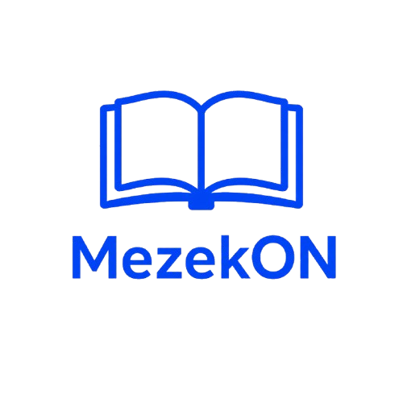

# 📖 MezekON

**MezekON** is a mobile platform where language lives, breathes, and is passed on — a hybrid space that blends the warmth of a social network with the precision of a **living dictionary**, built with one mission at its **heart**: to gather **Bulgarian dialect words** in one place and make sure not a single one is lost to time.

At its core, MezekON is a **social media platform and a dictionary in one**. Every user becomes both a keeper and a discoverer of language. They can add words they grew up hearing — from their grandmother's kitchen, from a village they left long ago, from a region whose speech is fading — and give each one a home: its meaning, its region, its pronunciation, the story behind it. Other users can react, comment, confirm, or offer their own version, turning every entry into a small act of collective memory. Over time, these contributions build into a rich, searchable, community-driven archive of Bulgarian dialects — a dictionary written not by institutions, but by the people who speak it.
---

## 🌟 Purpose

MezekON exists to **preserve, celebrate, and share** Bulgarian cultural heritage — its dialect words, folklore, and songs — before they slip away.

We do this by:

- **Building living profiles** — every user becomes a keeper of the words and traditions they carry, turning personal memory into a public archive
- **Creating a shared space** — a community where Bulgarians at home and across the diaspora can collaborate, contribute, and see their culture reflected back at them
- **Making heritage interactive** — remembering, discovering, and sharing Bulgarian history becomes something playful and hands-on - by using the device that is one hand reach away: your personal phone!!
---

## 🧩 Features

### 🔐 Authentication

- User registration, login, and logout system
- The first building block for your opportunities in MezekON

### 👤 MezekON Profiles

- Public profiles including:
    - Username, bio, and location
    - General information about the account such as the followers and the following
    - Personal settings that change the look and feel of the application

## 👨‍💼 User Roles & Hierarchy

MezekON uses a **tiered role system** to reflect a member's journey through the platform — from a curious newcomer to a full administrator. Each role unlocks specific capabilities, and users may hold **multiple roles at once**, often tied to a specific region.

A user's effective permissions are determined by their **highest active role**. This means that if a user holds several roles, the platform always checks what the most powerful one allows before deciding what they can do.

The system is built on two foundations:

1. **Roles** — nine distinct tiers, each with a numeric hierarchy level and a fixed set of permissions.
2. **Regions** — optional regional assignments that let certain roles (especially Guardians) exercise authority over a specific area of Bulgaria.

Roles are stored per user, can be **activated** or **deactivated** without being deleted, and can be **tied to a region** where relevant. Every role a user holds is tracked with when it was unlocked, whether it is currently active, and — for regional roles — which region it applies to.

---

### 📊 Role Hierarchy

The hierarchy below ranks every role from lowest to highest. A higher number means greater authority.

| Level | Role | Unlocks at | Summary |
|:-----:|------|:----------:|---------|
| 10 | 🧭 **Explorer** | Default on signup | The starting point — can submit words |
| 20 | 📖 **Narrator** | — | Can submit words and stories |
| 40 | ✍️ **Contributor** | — | Submits words, begins contributing to the archive |
| 50 | 🗃️ **Collector** | — | Can submit **and edit** words |
| 55 | 🔑 **Keeper** | — | Trusted custodian — submits and edits |
| 80 | 🛡️ **Guardian** | Regional appointment | Verifies words and manages a region |
| 85 | 🎨 **Curator** | — | Verifies words and reviews reports |
| 90 | 🎓 **Scholar** | — | Full editorial + user management, minus role assignment |
| 100 | 👑 **Admin** | — | Unrestricted access to everything |

> **Note:** A role's hierarchy level determines *rank*, but a role's *permissions* are defined explicitly (see the Permission Matrix further down). A higher level always means equal or greater capability — never less.

---

### 🧩 Role Descriptions & Privileges

Each role's permissions are listed below, exactly as defined in the platform's permission system. A ✅ means the role **can** perform the action; a ❌ means it **cannot**.

#### 🧭 Explorer — *Level 10*

The default role assigned to every new user the moment they join MezekON. An Explorer is a **discoverer** — free to explore the archive, react to entries, and contribute their very first dialect words. This role exists to lower the barrier to entry: anyone can begin preserving their heritage immediately, with no approval required.

- ✅ **Submit words**
- ❌ Edit words · Verify words · Manage users · Assign roles · Access admin panel · View reports · Manage regions

#### 📖 Narrator — *Level 20*

A storyteller. Where other roles focus on individual words, Narrators capture the **stories, songs, and context** that surround them — the anecdote behind a phrase, the lullaby a grandmother sang, the saying a village lived by. Narrators enrich the archive with the human texture that makes language worth preserving.

- ✅ **Submit words**
- ❌ Edit · Verify · Manage users · Assign roles · Admin panel · View reports · Manage regions

#### ✍️ Contributor — *Level 40*

An active participant in building the archive. Contributors regularly add dialect words and enrich entries with meaning, origin, and regional notes. They are the steady engine of the dictionary — the members who show up consistently to grow the collection.

- ✅ **Submit words**
- ❌ Edit · Verify · Manage users · Assign roles · Admin panel · View reports · Manage regions

#### 🗃️ Collector — *Level 50*

A collector of language. Beyond submitting new entries, Collectors can **refine and correct** existing ones — fixing a misspelled word, clarifying a definition, or adding a missing region. This is the first role granted editorial power over content that already exists.

- ✅ **Submit words** · **Edit words**
- ❌ Verify · Manage users · Assign roles · Admin panel · View reports · Manage regions

#### 🔑 Keeper — *Level 55*

A trusted custodian of the archive. Keepers safeguard the quality of entries through editing and are considered reliable stewards of the collection. They hold the same permissions as Collectors but sit higher in the hierarchy, reflecting the trust placed in them. Final verification, however, still rests with higher roles.

- ✅ **Submit words** · **Edit words**
- ❌ Verify · Manage users · Assign roles · Admin panel · View reports · Manage regions

#### 🛡️ Guardian — *Level 80*

A **regional authority**. Guardians are appointed — not self-assigned — to oversee a specific region, verify its dialect words, and request supporting evidence from contributors. They are the local experts: the people who know how a word is *actually* said in their part of Bulgaria.

- ✅ **Submit** · **Edit** · **Verify** · **Manage regions**
- ❌ Manage users · Assign roles · Admin panel · View reports

> Guardians also carry a set of **region-specific powers** described in the *Regional Guardians* section below.

#### 🎨 Curator — *Level 85*

A quality gatekeeper. Curators verify words across the entire archive — not just one region — and review reported content. They ensure that what enters the dictionary meets the platform's standards, and they help keep the community healthy by acting on reports.

- ✅ **Submit** · **Edit** · **Verify** · **View reports**
- ❌ Manage users · Assign roles · Admin panel · Manage regions

#### 🎓 Scholar — *Level 90*

A senior authority. Scholars can manage users, manage regions, access the admin panel, and review reports — but they **cannot assign roles**. This makes the Scholar a powerful editorial and administrative figure who stops just short of controlling who gets which title.

- ✅ **Submit** · **Edit** · **Verify** · **Manage users** · **Admin panel** · **View reports** · **Manage regions**
- ❌ Assign roles

#### 👑 Admin — *Level 100*

Unrestricted access. Admins govern the entire platform — its users, roles, regions, content, and reports. There is no action in MezekON an Admin cannot perform.

- ✅ **Everything**: Submit · Edit · Verify · Manage users · Assign roles · Admin panel · View reports · Manage regions

---

### 🛡️ Regional Guardians

A **Guardian** is a special role tied to a **specific region**. Unlike standard roles, Guardians are **appointed** rather than self-assigned, and carry additional per-region powers that no other role possesses.

Guardianship is not just a title — it is a **responsibility over a place**. A Guardian is expected to know their region's dialect intimately and to act as the final word on whether a submitted word truly belongs to it.

**Appointment details:**

- **Appointed by:** Admin, Guardian, or Keeper
- **Tracks:** who appointed them, their appointer's role, and when the appointment was made
- **Tied to:** a single named region (`region_name`)

**Guardian-specific permissions:**

| Permission | Description |
|------------|-------------|
| `can_verify_words` | Approve or reject dialect word submissions for their region |
| `can_request_evidence` | Ask contributors for proof, sources, or audio recordings |
| `is_active` | Whether the guardianship is currently in effect |

**Permission levels** (as computed by the platform):

| Level | Condition | Meaning |
|-------|-----------|---------|
| 🟢 **Full** | Can verify **and** request evidence | Complete regional authority |
| 🟡 **Limited** | Can verify **or** request evidence | Partial authority |
| ⚪ **Readonly** | Neither, or inactive | No active regional power |

Guardians can be **deactivated** and **reactivated** without losing their appointment record, and their region can be reassigned. This means a Guardian's history is preserved even if their authority is paused — the platform remembers who appointed them and when.

---

### 🔐 Permission Matrix

The full breakdown of every role's capabilities at a glance:

| Permission | Explorer | Narrator | Contributor | Collector | Keeper | Guardian | Curator | Scholar | Admin |
|------------|:--------:|:--------:|:-----------:|:---------:|:------:|:--------:|:-------:|:-------:|:-----:|
| **Submit words** | ✅ | ✅ | ✅ | ✅ | ✅ | ✅ | ✅ | ✅ | ✅ |
| **Edit words** | ❌ | ❌ | ❌ | ✅ | ✅ | ✅ | ✅ | ✅ | ✅ |
| **Verify words** | ❌ | ❌ | ❌ | ❌ | ❌ | ✅ | ✅ | ✅ | ✅ |
| **Manage users** | ❌ | ❌ | ❌ | ❌ | ❌ | ❌ | ❌ | ✅ | ✅ |
| **Assign roles** | ❌ | ❌ | ❌ | ❌ | ❌ | ❌ | ❌ | ❌ | ✅ |
| **Admin panel** | ❌ | ❌ | ❌ | ❌ | ❌ | ❌ | ❌ | ✅ | ✅ |
| **View reports** | ❌ | ❌ | ❌ | ❌ | ❌ | ❌ | ✅ | ✅ | ✅ |
| **Manage regions** | ❌ | ❌ | ❌ | ❌ | ❌ | ✅ | ❌ | ✅ | ✅ |
| **Level** | 10 | 20 | 40 | 50 | 55 | 80 | 85 | 90 | 100 |

---

### 👤 Profile Data by Role

Every role shares the same **public profile foundation**, but higher roles unlock additional fields and controls.

**Universal (all roles):**

- Username, bio, and location
- Followers and following counts
- Portfolio certificates and past organization positions
- Flagged services
- Account reviews

**Role-gated additions:**

- **Keeper and above** — edit history on entries
- **Guardian** — region assignment, verification queue, evidence requests
- **Curator and above** — access to reported content
- **Scholar and above** — user management tools, region management
- **Admin** — full role assignment panel and platform-wide oversight

---

### 📌 Role Assignment Rules

- A user **cannot hold the same role for the same region twice** — the system rejects duplicates.
- Roles can be **deactivated** (paused) without being revoked, and reactivated later.
- A user may hold **multiple roles across different regions** simultaneously.
- The **default role** (`explorer`) is created automatically for new users.
- Only **Admins** can assign roles. **Scholars** can manage users but cannot assign roles.
- Role changes are tracked with a timestamp (`unlocked_at`) and an update history.

### 🗂️ Home Page

   -This is where users can get hands-on experience with bulgarian dialect word by playing a wordle-like game but with **bulgarian dialect words**. The main page also offers those who have more privileges other than viewing the application content to monitor resources such as user reports, words, history pdf archives and sound files

## 🌟 Dictionary Page

This is where the dialect words are collected and displayed. Each user, regardless of their role can commit words which can be later reviewed and processed by higher authorities in the application hierarchy. The page features a filter for the dialect words that can enable users to discover only specified range of the collected words by a certain criteria.

## 🌟 Events Page

this page is split into 4 sub=pages:

-- Artickle Section
-- History
-- News
-- Events

### ✨ Platform Features

- **Secure Messaging**: Built-in communication system
- **Review System**: Manage user reports and submissions - your engagement in the process matters!!
- **Interactive Wordle-like-game**: Experiance the traditional bulgarian language by playing the crosswords

### 🛠 Admin Panel (admins only)

- **Blacklist Management** – Manage reported content like comments, pdf archive submissions, uploaded audio files
- **Users and Organization Management** – Track user roles, assign and deactivate roles when needed to protect the community
- **Services Management** – Track total services, availabilities and comments

---
### Follow these steps to get the MezekON application up and running on your local machine for development and testing purposes.
---

### **Client Application Setup**

1. **Clone the Repository**:  
   You can clone the repository using the following command or download it as a ZIP file and extract it on your
   computer.

   ```bash
   git clone https://github.com/coffee4urhead/MezekOn.git
   ```

2. **Navigate to the Project Directory**:  
   Use the terminal to navigate to the project directory.

   ```bash
   cd MezekON
   ```

4. **Install Dependencies**:  
   Install all the necessary dependencies by running the following command in your terminal:

   ```bash
   npm i
   ```
5. **Run the expo server**:  
   ```bash
   npx expo start
   ```

6. **Prepare your custom Appwrite instance as the backend and implement the .env file with the required API tokens for each collection**:  
   To enable the app functionality for now the app is designed with the help of Appwrite. In the future the backend will be implemented using Django and Postgres but for now it is done via the ready-to-use system running from docker containers. Appwrite is run following the offical appwrite documentation at: <a href="https://appwrite.io/docs/quick-starts/react-native">Appwrite docs</a>

🛠️ **Technologies and Tools**
   The backend is hosted into a local web server that uses a cloudflare domain. For safety reasons we won't share the domain
<p align="left">


<p>
   
   React Redux
</p>
<p>
   
   Zustand
</p>

          
</p>

---
## 🙏 Special Thanks

This project's Wordle-inspired word game component was inspired by and adapted from the work of **Marty M.** ([@martymfly](https://github.com/martymfly)).

- **Original Repository:** [martymfly/react-native-wordle](https://github.com/martymfly/react-native-wordle)
- **Description:** A Wordle clone built with React Native & Expo, featuring the classic six-attempt, five-letter word guessing game with colored tile feedback.
- **License:** MIT

We are grateful for their contribution to the open-source community, which made it possible to explore and learn from a well-structured React Native implementation. Their work served as a valuable reference for integrating similar gameplay mechanics into MezekON.

Thank you, Marty! 🧩

### 📚 Libraries

- **expo** – Core Expo SDK and development platform for the app
- **react-native** – Cross-platform framework for building native mobile UIs
- **react** – Core React library powering the component model
- **expo-router** – File-based routing and navigation for Expo apps
- **react-navigation/bottom-tabs** – Bottom tab navigator for primary app navigation
- **react-navigation/material-top-tabs** – Swipeable top tab navigation between screens
- **react-navigation/elements** – Shared UI building blocks for React Navigation
- **react-native-screens** – Native screen optimization for navigation performance
- **react-native-safe-area-context** – Handles safe area insets across devices
- **react-native-gesture-handler** – Native gesture system for touch interactions
- **react-native-reanimated** – High-performance animations on the UI thread
- **react-native-worklets** – Worklet runtime powering Reanimated animations
- **moti** – Declarative animation library built on Reanimated
- **lottie-react-native** – Renders Lottie vector animations natively
- **expo-linear-gradient** – Native linear gradient backgrounds
- **expo-blur** – Native blur effects for glassmorphism-style UI
- **expo-image** – Optimized image component with caching and placeholders
- **expo-symbols** – Native SF Symbols support on iOS
- **expo/vector-icons** – Icon set (Ionicons, Material, FontAwesome, etc.)
- **expo/ui** – Native UI primitives for Expo
- **zustand** – Lightweight state management for global app state
- **reduxjs/toolkit** – Redux toolkit for structured, scalable state logic
- **react-redux** – Official React bindings for Redux
- **react-native-appwrite** – Appwrite backend SDK for auth, database, and storage
- **react-native-mmkv** – Fast, synchronous key-value storage on native
- **react-native-async-storage/async-storage** – Persistent async storage for React Native
- **react-native-nitro-modules** – Native module framework powering MMKV and other nitro packages
- **react-native-maps** – Native map components for iOS and Android
- **react-native-community/geolocation** – Cross-platform geolocation access
- **expo-location** – Foreground and background location services
- **expo-notifications** – Push and local notification handling
- **expo-device** – Device information and capability detection
- **react-native-community/datetimepicker** – Native date and time picker
- **react-native-community/slider** – Native slider input component
- **react-native-pager-view** – Native paged view for swipeable screens
- **react-native-tab-view** – Tab view component for React Native
- **react-native-popover-view** – Popover/menu component
- **react-native-webview** – Embedded web content in a native WebView
- **expo-web-browser** – In-app browser for external links
- **expo-audio** – Audio playback and recording
- **expo-video** – Native video playback
- **expo-image-picker** – Access to camera and photo library
- **expo-document-picker** – Native file and document selection
- **expo-file-system** – Read/write access to the device file system
- **react-native-fs** – File system access for React Native
- **react-native-file-access** – Additional file system utilities
- **react-native-blob-util** – Blob and file handling for binary data
- **expo-asset** – Bundles and loads static assets
- **expo-font** – Custom font loading
- **expo-constants** – Access to app config and constants
- **expo-linking** – Deep linking and URL handling
- **expo-splash-screen** – Native splash screen control
- **expo-status-bar** – Status bar styling
- **expo-system-ui** – System UI color and appearance control
- **expo-haptics** – Haptic feedback on supported devices
- **expo-build-properties** – Configure native build settings via app config
- **expo-dev-client** – Custom development client for native builds
- **react-native-dotenv** – Loads environment variables from `.env`
- **ajv** – JSON schema validation
- **blur** – Blur utilities
- **eas** – Expo Application Services CLI helper

🛠️ **Key Integrations**:

- **Appwrite** via `react-native-appwrite` for authentication, database, and storage
- **Zustand** for lightweight, hook-based global state management
- **MMKV** via `react-native-mmkv` for fast, synchronous native key-value storage